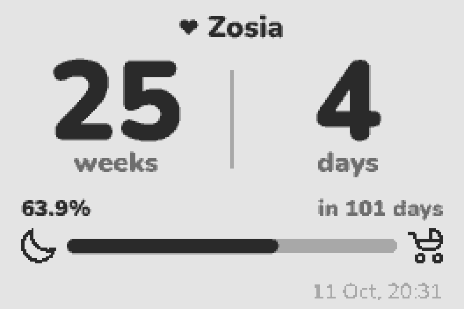
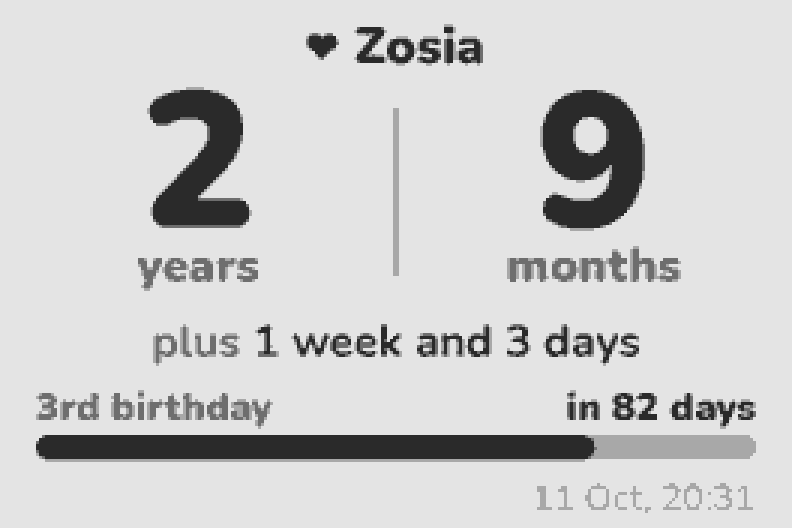
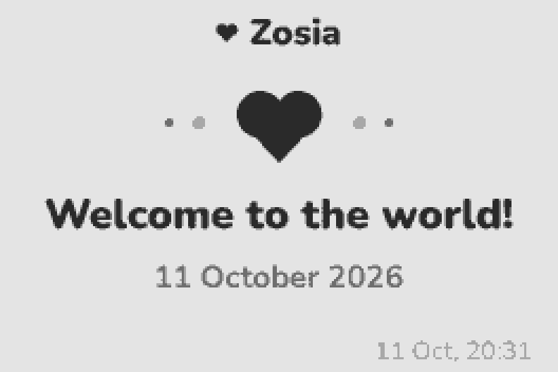
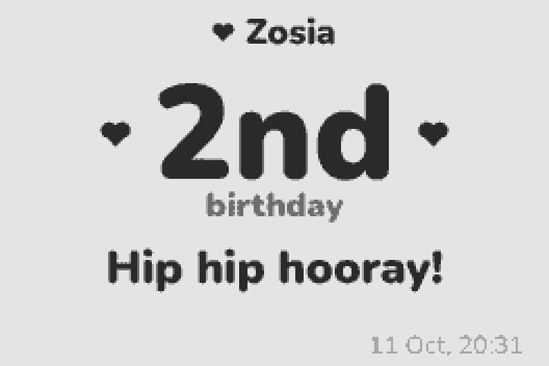
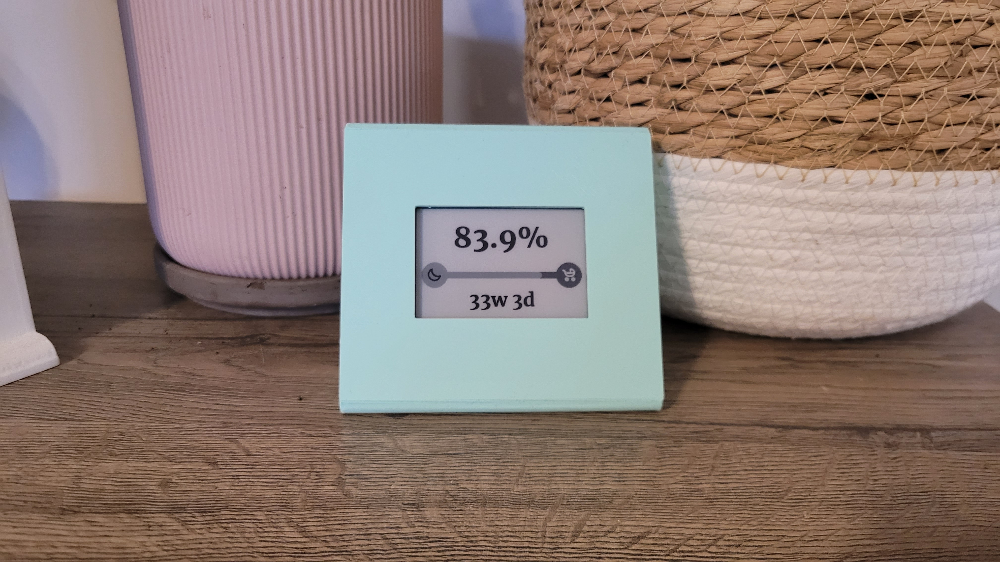

# E-ink Baby Tracker

A small Raspberry Pi project that follows a baby from pregnancy to birthdays on a [Waveshare 2.7 inch e-Paper HAT](https://www.waveshare.com/2.7inch-e-paper-hat.htm) (264 × 176 pixels, 4 gray levels). A cron job redraws the screen once an hour; between refreshes the e-paper panel holds the image without power.

| Pregnancy | Age |
|---|---|
|  |  |
| **Day of birth** | **Birthday** |
|  |  |

The screen is in English by default and can be switched to Polish:

| Pregnancy (pl) | Age (pl) |
|---|---|
|  |  |



## What it shows

The screen picks itself from the dates in `config.json` and today's date:

* **Pregnancy** – during the 280 days (40 weeks) before the due date: completed weeks and days, the percentage done, a bar from the moon to the carriage, and the days left. On the due date it says "due today"; after it, it keeps counting and shows "N days overdue".
* **Countdown** – more than 40 weeks before the due date: just the number of days until birth.
* **Welcome** – on the day of birth.
* **Age** – from the next day on: the two largest units of the baby's age (for example years and months) as big numbers, the smaller units underneath, and a bar counting down to the next birthday.
* **Birthday** – on every birthday.

Every screen has a title (the baby's name, or the birth or due date) and a small gray timestamp in the bottom-right corner showing when it was last refreshed. If the timestamp stops moving, the Pi has stopped running the job.

## Hardware

* A Raspberry Pi (any model with a 40-pin header; a Pi Zero fits the case linked below).
* The [Waveshare 2.7 inch e-Paper HAT](https://www.waveshare.com/2.7inch-e-paper-hat.htm). `main.py` loads the `epd2in7` driver from the `waveshare-epaper` package.

## Setup

1. Prepare the Raspberry Pi (enable SPI, install the Waveshare libraries) following the [Waveshare docs](https://www.waveshare.com/wiki/2.7inch_e-Paper_HAT_Manual#Working_With_Raspberry_Pi).
2. Clone this repository:
    ```
    git clone https://github.com/grappeq/e-ink-baby-tracker.git
    cd e-ink-baby-tracker
    ```
3. Install the Python dependencies:
    ```
    pip3 install -r requirements.txt
    ```
4. Install libopenjp2, which Pillow needs:
    ```
    sudo apt-get install libopenjp2-7
    ```
5. Copy `config.json.example` to `config.json` and fill it in (see [Configuration](#configuration)).
6. Run it once by hand to check that the panel refreshes:
    ```
    python3 main.py
    ```
7. Add two lines to your crontab (`crontab -e`): one to refresh every hour, and one to refresh after a reboot. The Pi has no real-time clock, so the boot entry waits for NTP to set the time first:
    ```
    4 * * * * python3 /home/pi/e-ink-baby-tracker/main.py
    @reboot sleep 90 && python3 /home/pi/e-ink-baby-tracker/main.py
    ```
    Adjust the path if you cloned the repository somewhere else.

## Configuration

`config.json` lives next to `main.py`:

```json
{
  "expected_birth_date": "2027-01-20",
  "birth_date": null,
  "name": "Zosia",
  "language": "en"
}
```

| Key | Meaning |
|---|---|
| `expected_birth_date` | The due date, `YYYY-MM-DD`. The pregnancy is counted as the 280 days before it. |
| `birth_date` | The actual birth date, `YYYY-MM-DD`. Set it once the baby is born to switch to the welcome, age and birthday screens. If it is never set, the due date is used as the birth date once it is more than 3 weeks in the past. |
| `name` | Optional. Shown as the title; long names are shortened to fit. Without it the title is the due date, or "born" plus the birth date. |
| `language` | `en` (default) or `pl`. An unknown value falls back to English. |

Either date on its own is enough: a config with only `birth_date` shows the pregnancy before that date, and a config with only `expected_birth_date` switches to the age screens three weeks after it.

## What happens on each run

`main.py` is meant to be run unattended, so it keeps a record of itself:

* It exits with code `0` on success and `1` on any failure (a bad config, a missing dependency, a panel that will not initialise, and so on).
* Each run appends one line to `baby-tracker.log` next to `main.py`, for example `2026-10-11 10:04:02 INFO OK state=pregnancy` (the age screen is logged as `state=normal`). The log is rotated at 256 KB and one backup (`baby-tracker.log.1`) is kept, so it never grows past half a megabyte.
* Failures are also printed to stderr, which cron mails to you if mail is set up. They are already in `baby-tracker.log`, so there is no need to redirect stderr to another file (which would grow without limit).
* The image is drawn before the panel is powered, and the panel is always put back to sleep afterwards, even when the run fails part-way through. A drawing bug cannot leave the display powered.

## Upgrading from e-ink-pregnancy-tracker

This project used to be called *e-ink-pregnancy-tracker* and only showed the pregnancy screen. The old GitHub URL redirects, so an existing clone keeps working:

```
git pull
pip3 install -r requirements.txt
```

The second step matters: `python-dateutil` is a new dependency, and without it `main.py` exits with an error telling you to run it.

Your existing `config.json` keeps working as it is. When the baby arrives, add `"birth_date": "YYYY-MM-DD"` to it and the screen switches over on the next refresh.

If your crontab appended something like `&& date >> ~/run-log.txt` to the command to keep track of runs, you can drop it: `main.py` now writes `baby-tracker.log` itself.

## Previewing without the hardware

`local_test.py` renders any screen to a PNG (scaled up 3×, with tones approximating the panel) so you can try dates, names and languages on a laptop. It only needs Pillow and python-dateutil:

```
python3 local_test.py [expected_birth_date] [today] [--born DATE] [--name NAME] [--lang en|pl] [--time HH:MM] [--out FILE.png]
```

* `expected_birth_date` – the due date (defaults to `2027-01-20`).
* `today` – the date to render for (defaults to today).
* `--born` – the actual birth date, like `birth_date` in the config.
* `--name`, `--lang` – like `name` and `language` in the config.
* `--time` – the time shown as the refresh timestamp (defaults to now).
* `--out` – where to save the PNG. Without it, the image opens in your default viewer.

Some examples:

```
# 27 weeks into the pregnancy, in Polish
python3 local_test.py 2027-01-20 2026-10-21 --name Zosia --lang pl --out preview.png

# a few days overdue
python3 local_test.py 2026-10-05 2026-10-11 --out preview.png

# the welcome screen, then the age screen, then a birthday
python3 local_test.py 2026-10-11 2026-10-11 --born 2026-10-11 --out preview.png
python3 local_test.py 2026-10-11 2027-08-23 --born 2026-10-11 --name Zosia --out preview.png
python3 local_test.py 2026-10-11 2028-10-11 --born 2026-10-11 --out preview.png
```

Run the test suite with:

```
python3 -m unittest
```

## Project layout

```
main.py                     cron entry point: loads the config, draws the screen, drives the panel, logs
local_test.py               renders a screen to a PNG without the hardware
config.json.example         configuration template
baby_tracker/
  config.py                 reads config.json and builds the models below
  pregnancy.py              pregnancy maths: day, weeks + days, progress, days until due
  age.py                    age maths: years/months/weeks/days, next birthday
  screens/
    __init__.py             picks today's screen (select_state) and builds it (create_screen)
    base.py                 shared layout: title with the heart, big numbers, bars, timestamp
    pregnancy.py, countdown.py, welcome.py, age.py, birthday.py   one module per screen
  locales/
    __init__.py             language registry (get_locale)
    en.py, pl.py            all on-screen copy and date/number formatting per language
  fonts.py, icons.py, gray_scale.py   font loading, icon masks, 4-level quantisation
res/                        Nunito fonts and the moon/carriage icons
docs/                       screenshots and the photo above
tests/                      unit tests (python3 -m unittest)
```

**Adding a language:** copy `baby_tracker/locales/en.py` to a new module (say `de.py`), translate the constants and adapt the formatting functions, keeping the same names, then register it in the `LOCALES` dict in `baby_tracker/locales/__init__.py`. `tests/test_locales.py` lists the names every locale must provide. Screens render at 4× and downscale, so check the result with `local_test.py --lang de` to make sure longer words still fit.

**Adding a screen:** add a module in `baby_tracker/screens/` with a `Screen` subclass that sets `STATE` and implements `_draw_content()` (the title and timestamp are drawn for you), then add the state to `select_state()` and `SCREENS` in `baby_tracker/screens/__init__.py`.

## Useful resources

* [2.7 inch e-Paper HAT docs](https://www.waveshare.com/wiki/2.7inch_e-Paper_HAT)
* [3D-printable case for the display and a Raspberry Pi Zero](https://www.printables.com/model/538237-27-inch-e-ink-display-raspberry-pi-zero-case) (the one in the photo above)

## Credits and license

The project is released under the [MIT License](LICENSE).

The Nunito font is used under the [SIL Open Font License](res/fonts/OFL-Nunito.txt).
